# OncoPixel

**See beyond the image.** A desktop application that classifies brain tumors on 2D T1 MRI slices (glioma, meningioma, pituitary tumor, no tumor) and segments them, with a model confidence estimate, an editable tumor mask, measurements, comparison between two studies of a patient, and reports.

> **Research and demonstration use only.** AI-generated results must not replace professional clinical judgment. OncoPixel is not a medical device and makes no certification claim.

Everything runs on your own computer. There is no cloud service and no telemetry.

---

## What is real and what is not

| | Status |
|---|---|
| Interface, accounts, patients, import, history, review, exports, comparison, backup | Implemented and tested |
| Classification and segmentation | **They run only with the real trained checkpoints.** |
| Trained weights | Not stored in this Git repository (they are large). **Download them from the link in [Trained models](#trained-models-download).** |
| Missing or mismatched weights | The app says so (banner, Models page, HTTP 409) and **produces no result**. It never shows mock or invented predictions. |
| Random test weights (`make_test_fixtures.py`) | Used only by the automated tests. If one is loaded, a red "Untrained test model" banner is shown everywhere. |

Tested: 35 backend tests, 6 frontend tests, a scripted browser session covering the full flow (with random test weights, so no real predictions), and the checkpoint verifier with the real trained checkpoints on an Apple Silicon Mac (MPS), which passed.

## Screenshots

| | |
|---|---|
| 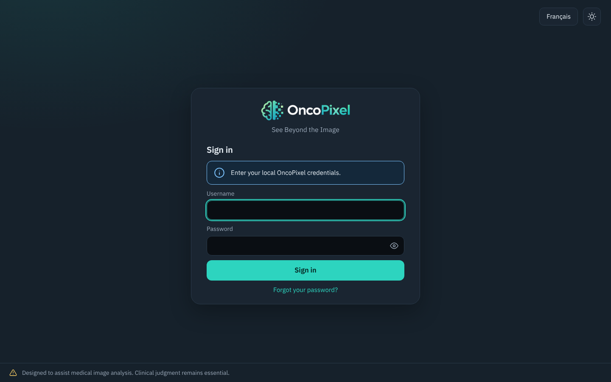 | 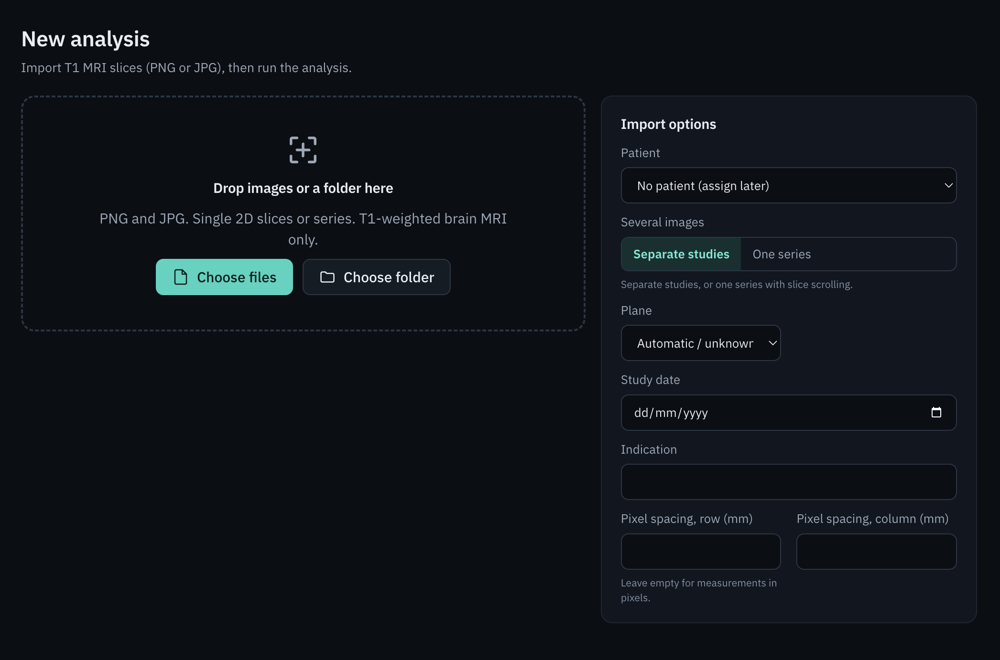 |
| Sign in (local account, show/hide password, forgot-password link) | New analysis: PNG or JPG import and patient options |

| | |
|---|---|
| 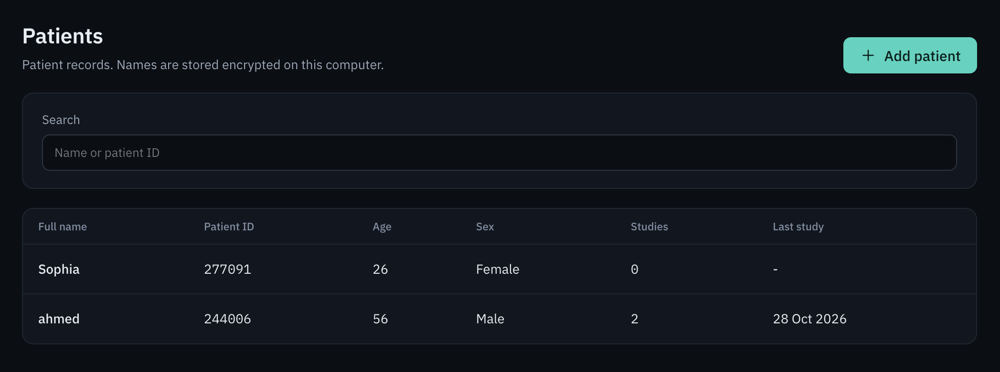 | 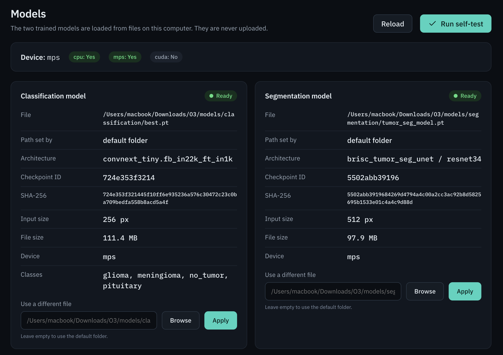 |
| Patients: local patient records | Models page: both checkpoints loaded and verified |

| | |
|---|---|
| 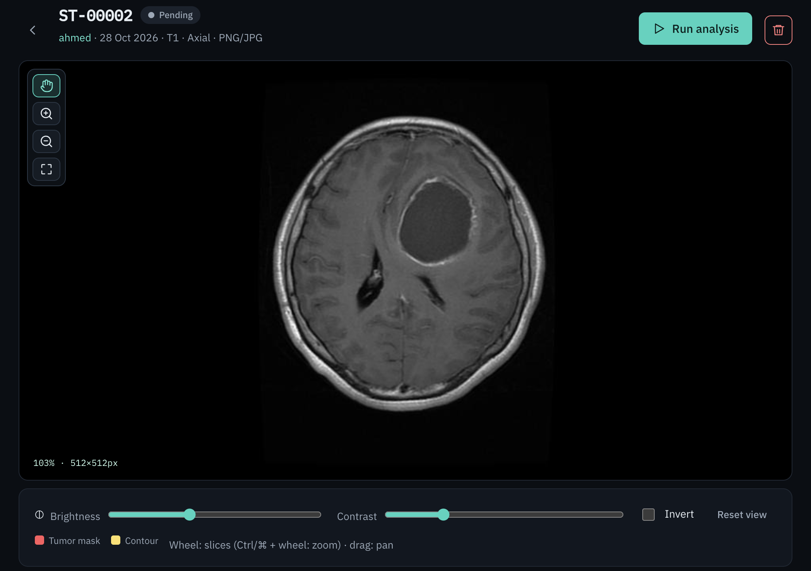 | 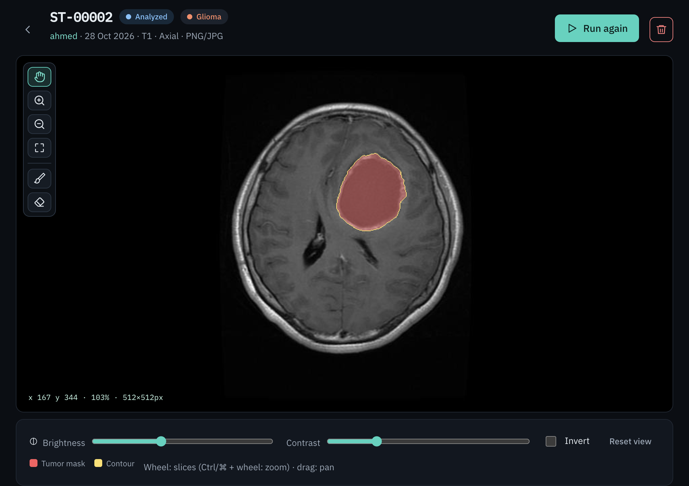 |
| A study ready to be analysed | Segmentation: tumour mask overlaid on the slice |

| | |
|---|---|
| 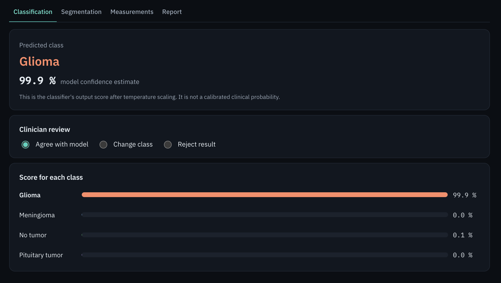 | 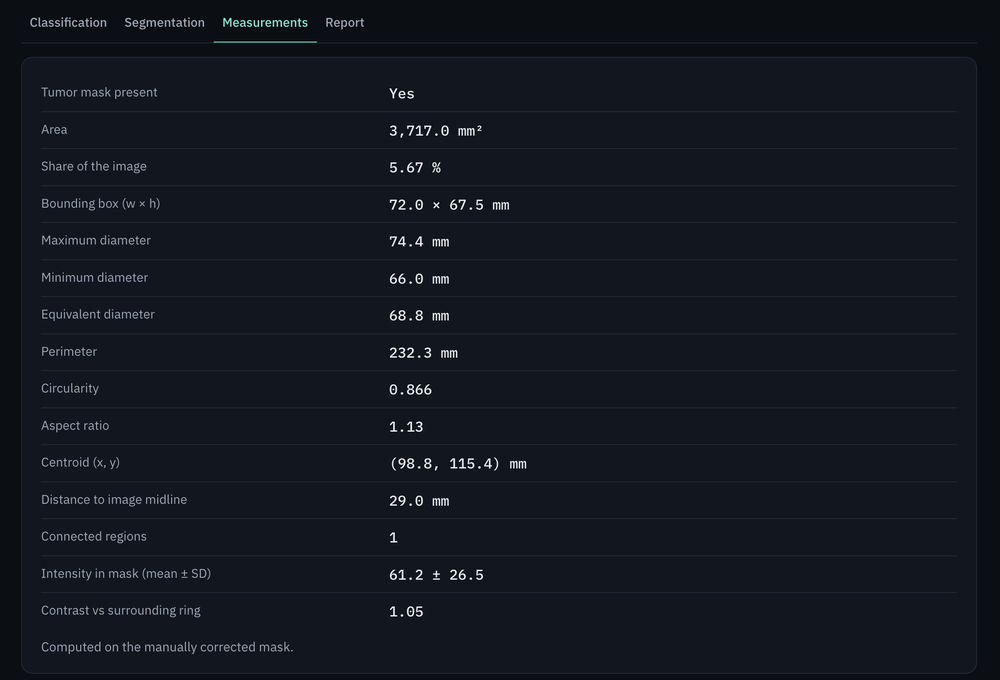 |
| Classification: predicted class with model confidence | Measurements derived from the mask |

| | |
|---|---|
| 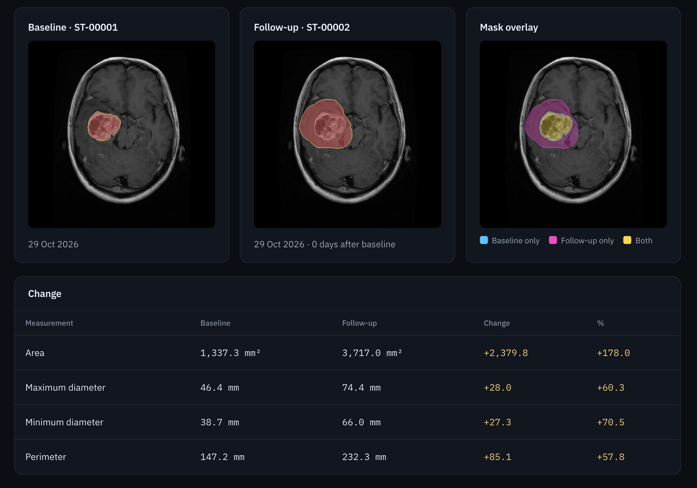 | 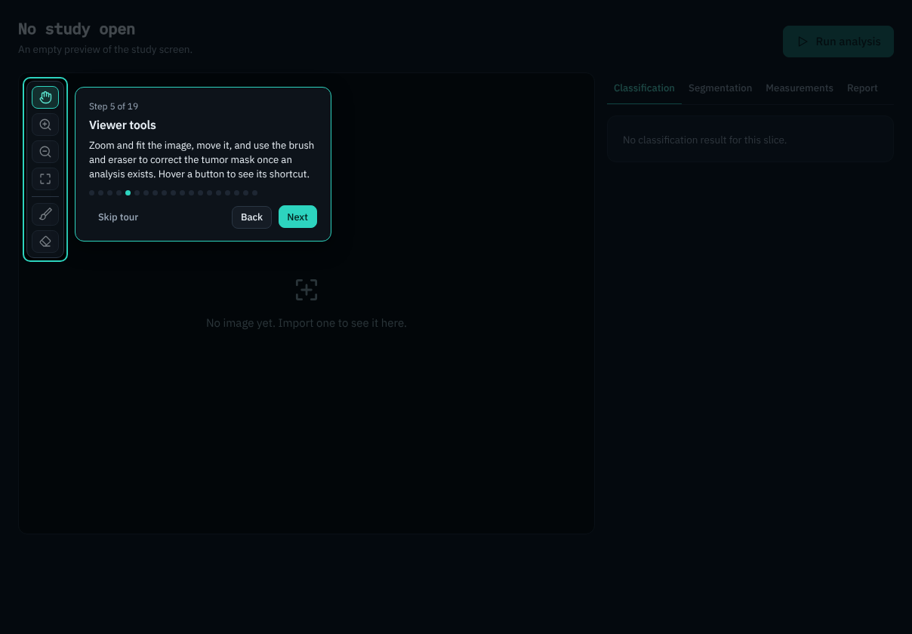 |
| Comparing two studies | Guided tour: viewer tools, image area, results tabs |

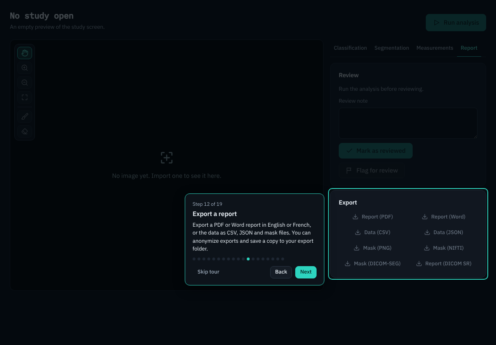

*Guided tour: notes, review and report export (PDF, Word, CSV, JSON, masks)*


## Quick start on a MacBook (Apple Silicon)

Requirements: macOS, Python 3.10 to 3.13, Node.js 18 or newer.

Tested on macOS (Apple Silicon) only. Windows and Linux have not been tested.

```bash
git clone <your repository> oncopixel && cd oncopixel      # or unzip the project
./scripts/setup-mac.sh                                      # venv + Python deps + npm install + build
```

1. Put the two checkpoints (download link in [Trained models](#trained-models-download)) here. Git ignores them:

   ```
   models/classification/best.pt
   models/segmentation/tumor_seg_model.pt
   ```

2. Check that each checkpoint matches its architecture and runs on your Mac:

   ```bash
   ./scripts/verify-models.sh                    # add: --image path/to/slice.png  for a real image
   ```

3. Start the application:

   ```bash
   ./scripts/run.sh                              # opens the desktop window
   ```

On first launch create the local account.

If macOS blocks the Electron window on first launch, run this from the repository root:

```bash
cd desktop
rm -rf node_modules/electron ~/Library/Caches/electron
npm install electron@33 --save-dev --foreground-scripts
xattr -cr node_modules/electron/dist/Electron.app
cd ..
./scripts/run.sh
```

or run the same application in a browser window: `./scripts/run.sh --browser`

To restart the application from scratch (this deletes all local data: account, patients and studies):

```bash
rm -rf ~/Library/Application\ Support/OncoPixel
```

## Project layout

```
backend/            FastAPI + PyTorch service (local, 127.0.0.1 only)
  oncopixel/
    ml/             classifier.py, segmenter.py, segmentation.py, registry.py, devices.py
    services/       import, analysis, measurements, comparison, validation, backup
    exports/        PDF, Word, CSV, JSON, mask PNG, NIfTI, DICOM-SEG, DICOM-SR
    api/            HTTP routes (auth, core, clinical)
  scripts/          make_test_fixtures.py, verify_checkpoints.py
  tests/            pytest suite
desktop/            Electron shell + React/TypeScript interface (Vite)
models/             where the checkpoints go (the .pt files are ignored by Git)
docs/               ARCHITECTURE, MODELS (verification), USER_MANUAL (EN/FR)
scripts/            setup, run, verify
```

Architecture, security model and data flow: [docs/ARCHITECTURE.md](docs/ARCHITECTURE.md). User manual (English and French): [docs/USER_MANUAL.md](docs/USER_MANUAL.md).

## Features

- Classification of four classes with a **model confidence estimate** (not a calibrated probability) and a review flag below a configurable threshold (default 90 %).
- Segmentation as a tumor mask with contour, overlay opacity and colour.
- Manual mask correction (brush, eraser, undo/redo), saved and used for measurements.
- 2D measurements: area, bounding box, maximum, minimum and equivalent diameters, perimeter, circularity, aspect ratio, centroid, distance to the image midline, intensity statistics. Millimetres only when the pixel spacing is entered by you. No volume.
- Import PNG and JPG images (single slices, series, folders), input validation with warnings.
- Patients with required fields, history with search, status (pending, analyzed, reviewed, flagged), review workflow.
- Clinician review: for each study, the user can agree with the model, change the predicted class, or reject the result, so the final decision always stays with a person.
- Comparison of two segmented studies of one patient.
- Reports in English or French: PDF, Word. Data: CSV, JSON. Masks: PNG, NIfTI, DICOM-SEG. DICOM SR.
- Local sign-in with scrypt password hashing and lockout, a one-time recovery key to reset a forgotten password, a show/hide password button, encryption of patient fields and images at rest, local activity log, manual encrypted backup and restore.
- English and French interface, dark and light themes, three text sizes, high contrast, keyboard shortcuts, guided tour.

## Trained models (download)

The two trained checkpoints are shared here so that you can try OncoPixel with real predictions:

**[Download the trained models (Google Drive)](https://drive.google.com/drive/folders/1pSnSBSWND9g4lnjkVn1wJHk9fcbtXaT0?usp=share_link)**

| File | Put it here | Model |
|---|---|---|
| `best.pt` | `models/classification/best.pt` | Classifier (ConvNeXt-Tiny, 4 classes) |
| `tumor_seg_model.pt` | `models/segmentation/tumor_seg_model.pt` | Segmenter (U-Net, ResNet-34 encoder) |

Then run `./scripts/verify-models.sh`. It must print `ALL CHECKS PASSED` before you trust any result. The weights are shared for evaluating and researching this project. They are not a certified medical product, and they have their own terms (see Licence).

## How the models are checked

Three layers, from the file up to the clinic.

1. **The checkpoint itself** (`./scripts/verify-models.sh`). The file is loaded with `weights_only=True`. The expected keys must be present, the class order must be exactly `glioma, meningioma, no_tumor, pituitary`, the network must be built without pre-trained weights and `load_state_dict(strict=True)` must succeed. A forward pass on the selected device (Apple MPS or CPU) must give finite numbers of the right shape. If anything fails, the Models page says why and **no analysis is produced**.
2. **Every study.** The input is validated (unreadable, tiny, blank or colour images are refused or warned). A study is flagged for human review when the classifier confidence is below the review threshold (90 % by default), when the two models disagree (next section), or when the input is not a T1 slice or is a colour image. A flagged study is never hidden: you see the flag and the reason.
3. **Comparison with an oncologist (planned).** To evaluate OncoPixel's predictions, the model outputs will be compared with an oncologist's assessments on images not used during training.

    - The oncologist will independently label the images without seeing OncoPixel's predictions.
    - The same images will be analyzed using OncoPixel.
    - Classification results will be compared for each tumor class, and the oncologist's tumor outlines will be compared with the model's segmentation masks.
    - Disagreements will be reviewed to identify differences between the model's predictions and the oncologist's assessments.

   **Status:** This comparison has not been carried out yet, so no clinical performance is claimed. Until it is done and a sufficient number of cases has been evaluated, OncoPixel remains a research prototype.

## What happens when the two models disagree

The classifier and the segmenter are two independent networks. OncoPixel never overrides one with the other. If the classifier says *no tumor* but the segmenter finds a region, or the classifier predicts a tumor but the mask is empty, then:

- both results are kept and shown as they are;
- the study is flagged "Flagged for human review" with the reason *The classifier and the segmentation disagree about whether a tumor is present*;
- the flag appears in the study list, on the dashboard counters and in the exported report;
- the study stays flagged until a person reviews it, and changing the result reopens a review that was already done.

The system's job in this case is to say "look at this one", not to decide.

## How patient data is protected

Everything stays on the computer that runs OncoPixel. There is no cloud service, no telemetry and no outgoing connection from the backend. The Electron window cancels every request that is not to the local backend.

| What | How |
|---|---|
| Images, masks, heat maps and exports kept by the app | Encrypted file by file with **Fernet** (AES-128-CBC with an HMAC-SHA256 integrity check) |
| Patient name, clinical history, study indication and original file names | Encrypted with the same key before they are written to the SQLite database |
| Patient code, age, sex, dates and study status | Stored **unencrypted** in the local database, so that the lists can be searched and sorted |
| The encryption key | Kept in the macOS Keychain. If the Keychain is unavailable, in a file readable only by the user (`0600`) in the data folder |
| Passwords | Never stored. Only a **scrypt** hash is kept, and sign-in is locked after 5 wrong attempts (30 seconds, doubling up to 15 minutes) |
| Forgotten password | A one-time **recovery key** is shown when the account is created, and only its scrypt hash is stored. It lets the user choose a new password. Without it the password cannot be recovered |
| The local API | Listens on `127.0.0.1` only, refuses other host names, and requires a random token that is created at each launch. The session cookie is `HttpOnly` and `SameSite=Strict` |
| Backups | One `.opbackup` file, sealed with a passphrase (scrypt-derived key). The passphrase cannot be recovered |

What this does **not** do: it does not protect an unlocked computer where the user is signed in, it is not tamper-proof, and the activity log is for the user's own information. OncoPixel is not certified for clinical data protection.

## Known limits

- The models were trained on 2D T1 slices of a public dataset (BRISC). The app warns on non-T1 sequences and colour images but cannot verify that an image is a brain T1 slice.
- PNG and JPG carry no pixel spacing, so measurements stay in pixels unless you enter the spacing.
- Only 2D T1 slices in PNG or JPG are imported. DICOM files and other formats are not accepted.
- One local user account. No sharing or multi-user features.

## Development

```bash
cd backend && source .venv/bin/activate && pytest -q           # backend tests (random-weight fixtures, no real weights needed)
cd desktop && npm test && npm run typecheck                     # frontend tests
cd desktop && npm run dev                                       # Vite dev server (proxy to the backend on :8765)
python -m oncopixel.server --port 8765                          # in backend/, for the dev server
```

Test fixtures are generated, not committed: `python backend/scripts/make_test_fixtures.py`.

## Troubleshooting

- *The window says the engine is not running*: run `./scripts/run.sh` from a terminal to see the Python error. Most often the virtual environment is missing (`./scripts/setup-mac.sh`) or a dependency failed to install.
- *Model banner stays red*: open **Models**; it shows the exact path searched and the reason. Paths can be changed there, by the `ONCOPIXEL_CLASSIFIER_CKPT` and `ONCOPIXEL_SEGMENTER_CKPT` environment variables, or by `ONCOPIXEL_MODELS_DIR`.
- *Slow or out of memory on 8 GB*: choose **CPU** in Settings, close other apps. MPS fallback to CPU for unsupported operators is already enabled.

## Who built what

**Hanane Nour El-Houda Metidji**: trained both AI models (the tumor classifier and the tumor segmenter), integrated them into OncoPixel, developed the application, and designed its medical imaging workflow.

## Questions you may have

**Is this a diagnostic tool?** No. It assists the analysis of a single 2D T1 MRI slice. The result is a model confidence estimate and a mask, and the doctor must review them. It is not a medical device and makes no certification claim.

**What does the percentage mean?** It is the classifier's output score after temperature scaling and flip averaging. It is called a "model confidence estimate" because it is not a calibrated clinical probability.

**What data were the models trained on?** On the public BRISC brain MRI dataset: 2D T1 slices of glioma, meningioma, pituitary tumor and no tumor. The classifier is a ConvNeXt-Tiny and the segmenter a U-Net with a ResNet-34 encoder. The training notebooks are not included in this repository. Accuracy on images from other scanners or hospitals has not been measured.

**What if the image is not a brain MRI?** OncoPixel cannot check that. It refuses unreadable, tiny and blank images and warns on colour images, and a low confidence flags the study, but the user is responsible for importing T1 brain slices.

**What if the models are missing or invalid?** The app says so on every screen and returns no result. It never shows a mock or invented prediction. This is tested automatically.

**Is any AI service or cloud used when I run it?** No. Both models run on your computer (Apple MPS or CPU). Nothing is uploaded.

**Which parts are AI and which are ordinary software?** Two networks: the classifier and the segmenter. Everything else (import, validation, measurements, patient records, review, comparison, reports, encryption, sign-in) is conventional code.

**Why a desktop application?** It is designed for hospital workstations, where staff reach patient data through authenticated clinical systems and browser access is often restricted for security reasons.

**Why can I only import PNG and JPG?** The models were trained on 2D slices exported as images. DICOM import is not supported. Reports can be exported in DICOM-SEG and DICOM SR formats. Import and export are independent: the models need image slices as input, while DICOM-SEG and DICOM SR are output formats for interoperability.

## Licence
MIT, see [LICENSE](LICENSE). The model weights and the BRISC dataset have their own terms.